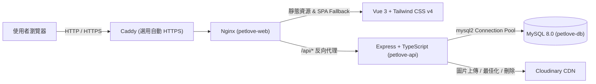

# PetLove 寵樂 — 寵物服務與電商全端平台

PetLove（寵樂）是一個以 **Vue 3 + TypeScript + Express + MySQL** 打造的全端寵物電商與會員服務網站，完整涵蓋前導動畫頁、品牌形象首頁、商品商城（分類／搜尋／分頁／多規格購物車）、會員中心、FAQ 客服系統，以及具備 **RBAC 角色權限控管** 與 **Cloudinary 雲端圖床** 的商品管理後台。

> **線上展示網址**：`https://<請填入你的正式網域或 VPS IP>`

---

## 面試測試帳號

資料庫首次初始化（`server/sql/init.sql`）會自動建立以下兩組展示帳號與 12 項多規格商品：

| 角色 | 電子信箱 | 密碼 | 可體驗功能 |
| :--- | :--- | :--- | :--- |
| **系統管理員** | `admin@petlove.demo` | `Admin1234!` | 完整前台功能 + `/admin/products` 商品上架、編輯、圖片上傳至 Cloudinary、刪除 |
| **一般會員** | `demo@petlove.demo` | `Demo1234!` | 登入驗證、會員中心各子頁、購物車與結帳流程（存取 `/admin` 會被權限守衛擋下） |

---

## 系統架構



---

## 技術棧與工程亮點

### 前端（`client/`）
- **Vue 3 (`<script setup lang="ts">`) + Vite 8 + Vue Router 5 + Pinia**
- **Tailwind CSS v4 + Lucide Icons**：全面採用 Mobile-First RWD 響應式設計，支援行動版抽屜導覽列與可收合會員側邊欄。
- **驗證與狀態管理**：
  - `Axios` 請求攔截器自動夾帶 `Bearer JWT`，回應攔截器集中處理 `401` 過期導向。
  - 路由守衛支援 `requiresAuth`、`requiresAdmin`、`guestOnly` 三種存取控管。
  - Pinia 購物車支援 `localStorage` 持久化同步、全館 88 折與滿 NT\$1,000 免運計算。

### 後端（`server/`）
- **Node.js (ESM) + Express + TypeScript + MySQL2**
- **安全認證與權限**：`bcrypt` 密碼雜湊、`JWT` 簽發與驗證、`requireAdmin` 即時查表確認管理員權限。
- **資料庫交易（Transaction）**：商品新增與編輯皆以 MySQL Transaction 原子寫入 `product` 與多組 `product_spec`，失敗時自動 Rollback 並清理已上傳圖片。
- **雲端圖床整合（Cloudinary）**：
  - 採用 `multer` 記憶體緩衝驗證格式（JPG/PNG/WebP/GIF）與 5MB 大小限制，通過欄位驗證後才串流上傳至 Cloudinary（自動縮放最大寬度 1200px 與 `f_auto,q_auto` 最佳化）。
  - 商品換圖或刪除時自動清理對應的 Cloudinary 舊圖；本機開發未設定憑證時自動退回 `server/uploads/`。

### 部署與維運（Docker + VPS）
- **Multi-stage Docker Build**：前後端分離多階段建置，後端採 `node:22-slim`（支援 `amd64` / Oracle Cloud `arm64` 原生 `bcrypt`）並以非 root 使用者執行。
- **Nginx 反向代理**：統一由 Port 80 對外提供 Vue SPA（含 `try_files` 解決 History Mode 重整 404）並同源代理 `/api/`，降低 CORS 與預檢開銷。
- **健康檢查與自動初始化**：Docker Compose 內建 MySQL 與 Express `/api/health` 健康檢查，確保服務依序啟動並自動匯入 `server/sql/init.sql`。

---

## 主要 API 一覽

| 方法 | 路徑 | 權限 | 說明 |
| :--- | :--- | :--- | :--- |
| `GET` | `/api/health` | 公開 | 服務與資料庫連線健康檢查 |
| `POST` | `/api/auth/register` | 公開 | 會員註冊（回傳 JWT） |
| `POST` | `/api/auth/login` | 公開 | 會員登入（回傳 JWT 與角色） |
| `GET` | `/api/auth/me` | 登入會員 | 取得目前登入者資料 |
| `GET` | `/api/products/categories` | 公開 | 取得商品分類清單 |
| `GET` | `/api/products` | 公開 | 商品查詢（支援 `category`、`keyword`、`page`、`limit`） |
| `GET` | `/api/products/:id` | 公開 | 取得單一商品詳情與所有規格 |
| `POST` | `/api/products` | 管理員 | 上架商品與多組規格（`multipart/form-data` 上傳圖片） |
| `PUT` | `/api/products/:id` | 管理員 | 更新商品、規格並替換舊圖 |
| `DELETE` | `/api/products/:id` | 管理員 | 刪除商品（級聯刪除規格並清理圖床圖片） |

---

## 本機開發啟動方式

### 1. 準備資料庫
在 MySQL 建立資料庫 `petlove_vue`，匯入 `server/sql/init.sql`。

### 2. 啟動後端
```bash
cd server
cp .env.example .env   # 填入 DB 密碼、JWT_SECRET（與選填 Cloudinary 憑證）
npm install
npm run dev            # http://localhost:3000
```

### 3. 啟動前端
```bash
cd client
cp .env.example .env
npm install
npm run dev            # http://localhost:5173
```

---

## 免費 VPS（Oracle Cloud Always Free）+ Docker + Cloudinary 部署指南

### 步驟 1：申請 Cloudinary 免費圖床
1. 前往 [Cloudinary](https://cloudinary.com/) 註冊免費帳號（25GB 免費額度）。
2. 於 Dashboard 記下三個值：`Cloud Name`、`API Key`、`API Secret`。

### 步驟 2：建立免費 VPS（以 Oracle Cloud Always Free Ubuntu 為例）
1. 建立 Ubuntu 22.04 / 24.04 VM（推薦 Always Free Ampere ARM64 規格，記憶體充裕）。
2. 在雲端控制台 **Security List / 防火牆規則** 開放 Ingress Port `22`（SSH）、`80`（HTTP）、`443`（HTTPS）。
3. SSH 連線進主機並開啟系統防火牆（若 Ubuntu 啟用 iptables / ufw）：
   ```bash
   sudo iptables -I INPUT 6 -m state --state NEW -p tcp --dport 80 -j ACCEPT
   sudo iptables -I INPUT 6 -m state --state NEW -p tcp --dport 443 -j ACCEPT
   sudo netfilter-persistent save
   ```

### 步驟 3：在 VPS 安裝 Docker 與 Docker Compose
```bash
curl -fsSL https://get.docker.com | sudo sh
sudo usermod -aG docker $USER
newgrp docker
docker --version && docker compose version
```

### 步驟 4：拉取專案並設定環境變數
```bash
git clone https://github.com/lovemintgreen/petlove-vue.git
cd petlove-vue
cp .env.docker.example .env
```
編輯 `.env`，至少修改以下欄位：
- `DB_ROOT_PASSWORD`、`DB_PASSWORD`：自訂強密碼
- `JWT_SECRET`：執行 `openssl rand -hex 32` 產生 64 字元隨機字串
- `CORS_ORIGIN`：填入 `http://<你的VPS公開IP>`（或正式網域 `https://xxx.duckdns.org`）
- `CLOUDINARY_CLOUD_NAME`、`CLOUDINARY_API_KEY`、`CLOUDINARY_API_SECRET`：填入步驟 1 取得的憑證

### 步驟 5：一鍵啟動全部服務
- **模式 A：僅使用 VPS 公開 IP（HTTP）**
  ```bash
  docker compose up -d --build
  ```
  啟動完成後開啟 `http://<你的VPS公開IP>` 即可瀏覽。

- **模式 B：綁定免費網域（例如 DuckDNS）自動啟用 HTTPS（推薦面試使用）**
  1. 到 [DuckDNS](https://www.duckdns.org/) 免費註冊子網域（如 `petlove-demo.duckdns.org`）並指向你的 VPS 公開 IP。
  2. 在 `.env` 填入 `APP_DOMAIN=petlove-demo.duckdns.org` 與 `CORS_ORIGIN=https://petlove-demo.duckdns.org`。
  3. 啟動含 Caddy 自動憑證的完整服務：
     ```bash
     docker compose -f docker-compose.yml -f docker-compose.https.yml up -d --build
     ```
  Caddy 會自動向 Let's Encrypt 申請並續期 SSL 憑證，幾秒後即可透過 `https://petlove-demo.duckdns.org` 存取。

### 步驟 6：驗收檢查指令
```bash
docker compose ps                         # 確認 db / server / client 皆為 Up (healthy)
curl http://localhost/api/health          # 應回傳 {"status":"ok","database":"connected"}
docker compose logs -f server             # 查看後端日誌
```

### 日常更新部署指令
```bash
git pull origin main
docker compose up -d --build              # 若啟用 HTTPS 則加上 -f docker-compose.https.yml
```
